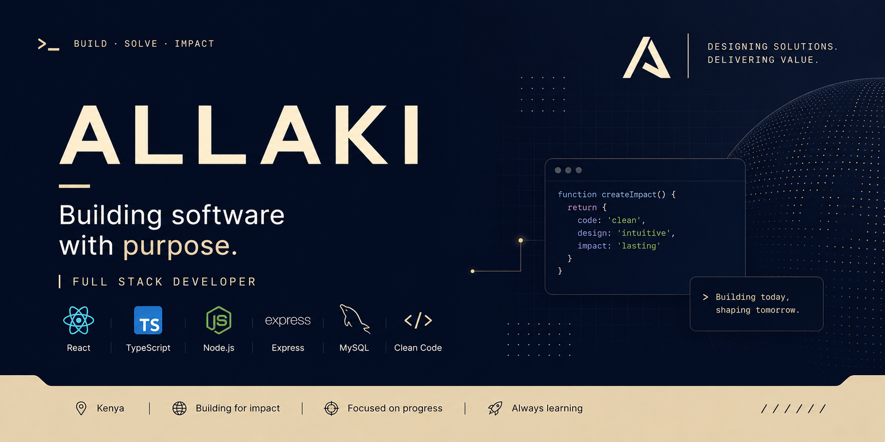
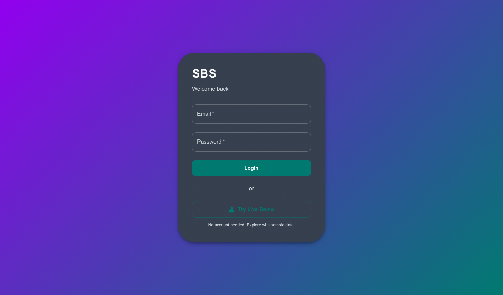
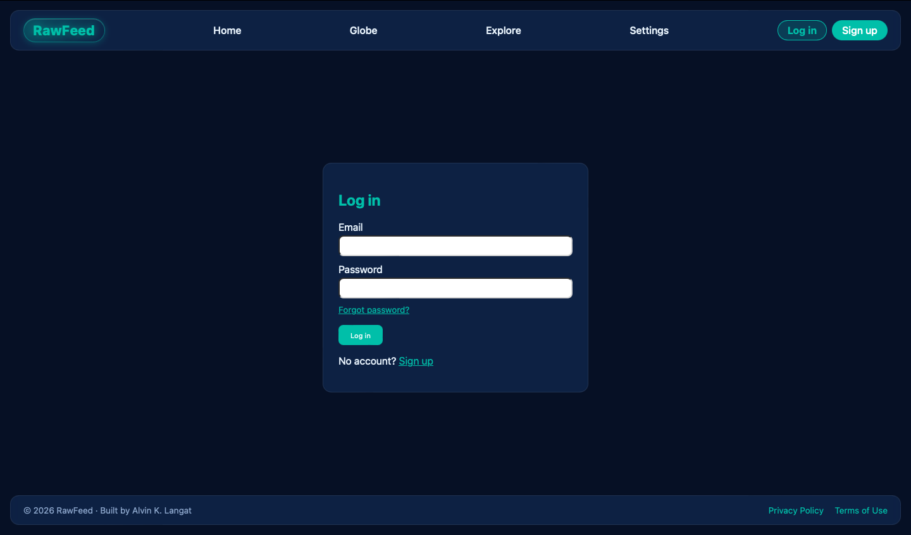
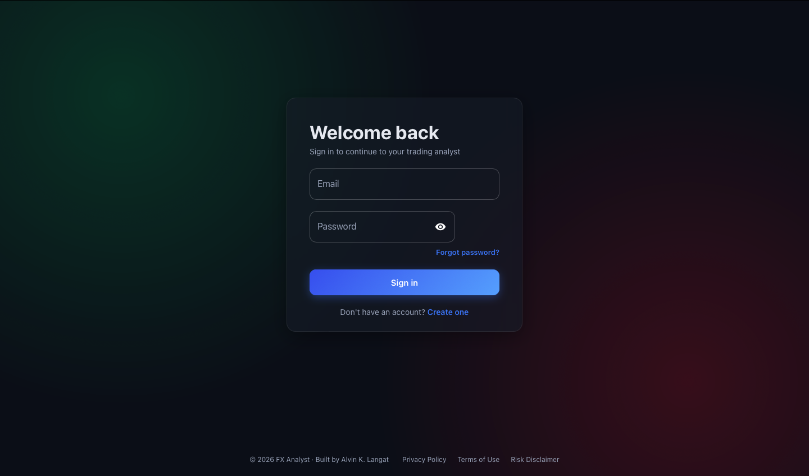
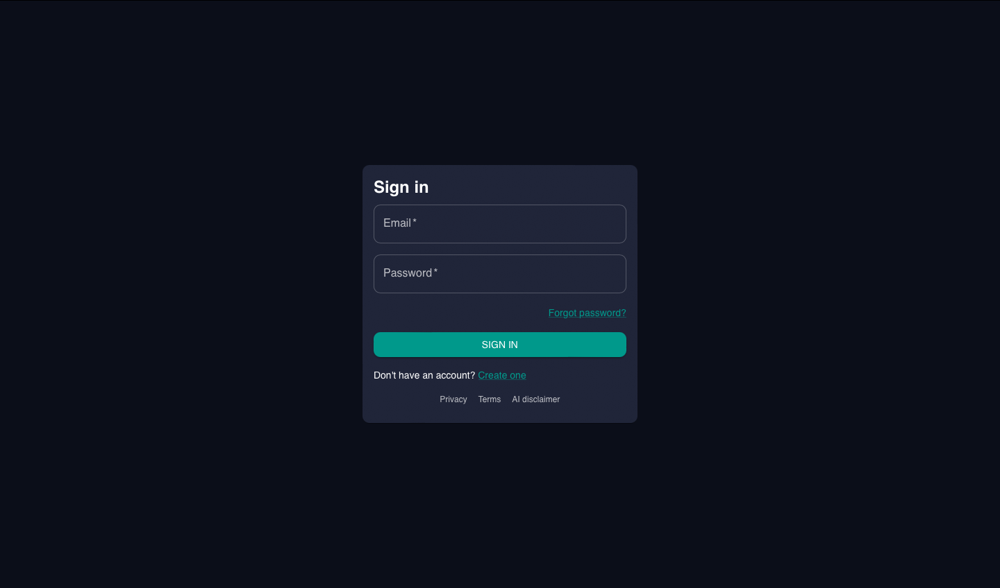
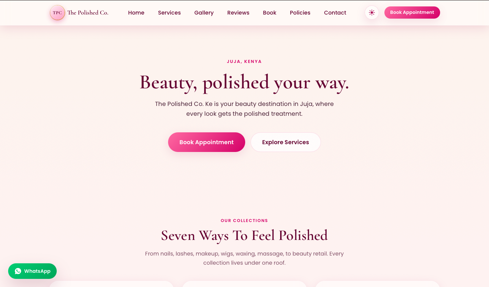
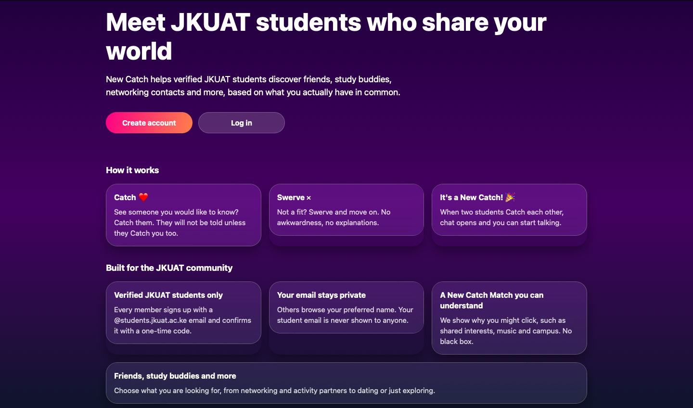

  

<h1 align="center">Alvin K. Langat</h1>

<strong>Business · Technology · Innovation</strong>

Building practical digital solutions at the intersection of business and technology.

  

<h2 align="center">FEATURED PROJECTS</h2>

<h3 align="center">Smart Bizz System</h3>

  

A modern, full featured business management platform designed to help manage products, sales, suppliers, customers, stock levels, and reports from a centralized system.

<strong>Built with:</strong> React • Node.js • Express.js • Prisma ORM • PostgreSQL

<a href="https://smart-bizz-system.vercel.app/">Live demo</a> • Source code: Private

 

<h3 align="center">RawFeed</h3>

  

A minimal information platform designed to help people stay informed about important real world events without depending on social media.

<strong>Built with:</strong> React • React Native • FastAPI • PostgreSQL • Ollama

<a href="https://rawfeed-news.vercel.app/">Live demo</a> • Source code: Private

 

<h3 align="center">Forex AI Analyst</h3>

  

Live forex and gold analysis that runs prices through a feature-engineering pipeline and six machine learning models to produce explainable recommendations with risk and invalidation conditions.

<strong>Built with:</strong> React • FastAPI • PostgreSQL (TimescaleDB) • scikit-learn • XGBoost

<a href="https://forex-analyst.vercel.app/">Live demo</a> • Source code: Private

 

<h3 align="center">Study Assistant AI</h3>

  

An AI powered learning platform that helps students understand, practice, organize, and track their studies using their own learning materials.

<strong>Built with:</strong> React • FastAPI • PostgreSQL (pgvector) • Google Gemini • Ollama

<a href="https://studyassistantai-ke.vercel.app/">Live demo</a> • Source code: Private

 

<h3 align="center">The Polished Co. Ke</h3>

  

Fully static website for a beauty studio in Juja, Kenya, with service collections, gallery, client reviews and appointment booking.

<strong>Built with:</strong> Astro • TypeScript • GitHub Pages

<a href="https://heisallaki.github.io/ThePolishedCo./">Live demo</a> • Source code: Private

 

<h3 align="center">New Catch</h3>

  

Social discovery app where verified JKUAT students meet through shared interests, with mutual matching before chat opens.

<strong>Built with:</strong> React Native • Expo • FastAPI • PostgreSQL • WebSockets

<a href="https://newcatch.pages.dev/">Live demo</a> • Source code: Private

<h2 align="center">TECH STACK</h2>

<h3 align="center">Frontend</h3>

  &nbsp;&nbsp;&nbsp;
  &nbsp;&nbsp;&nbsp;
  &nbsp;&nbsp;&nbsp;
  &nbsp;&nbsp;&nbsp;
  &nbsp;&nbsp;&nbsp;
  &nbsp;&nbsp;&nbsp;
  &nbsp;&nbsp;&nbsp;
  

<strong>Libraries:</strong> Recharts • jsPDF • SheetJS (xlsx)

 

<h3 align="center">Backend</h3>

  &nbsp;&nbsp;&nbsp;
  &nbsp;&nbsp;&nbsp;
  &nbsp;&nbsp;&nbsp;
  <picture>
    <source media="(prefers-color-scheme: dark)" srcset="https://cdn.simpleicons.org/express/FFFFFF">
    <source media="(prefers-color-scheme: light)" srcset="https://cdn.simpleicons.org/express/000000">
    
  </picture>&nbsp;&nbsp;&nbsp;
  <picture>
    <source media="(prefers-color-scheme: dark)" srcset="https://cdn.simpleicons.org/sqlalchemy/FFFFFF">
    <source media="(prefers-color-scheme: light)" srcset="https://cdn.simpleicons.org/sqlalchemy/000000">
    
  </picture>&nbsp;&nbsp;&nbsp;
  <picture>
    <source media="(prefers-color-scheme: dark)" srcset="https://cdn.simpleicons.org/prisma/FFFFFF">
    <source media="(prefers-color-scheme: light)" srcset="https://cdn.simpleicons.org/prisma/2D3748">
    
  </picture>

<strong>Python Backend:</strong> FastAPI • SQLAlchemy • Pydantic • Pydantic Settings • Alembic

<strong>Node.js Backend:</strong> Node.js • Express.js • Prisma ORM

<strong>Authentication:</strong> JWT • bcrypt

<strong>Caching:</strong> Redis

 

<h3 align="center">Database and Services</h3>

  &nbsp;&nbsp;&nbsp;
  

<strong>Database:</strong> PostgreSQL • Neon

<strong>Drivers:</strong> psycopg2

<strong>Services:</strong> Supabase

 

<h3 align="center">Testing</h3>

  

<strong>Testing:</strong> Pytest • HTTPX

 

<h3 align="center">Deployment</h3>

  <picture>
    <source media="(prefers-color-scheme: dark)" srcset="https://cdn.simpleicons.org/vercel/FFFFFF">
    <source media="(prefers-color-scheme: light)" srcset="https://cdn.simpleicons.org/vercel/000000">
    
  </picture>&nbsp;&nbsp;&nbsp;
  &nbsp;&nbsp;&nbsp;
  

<strong>Hosting:</strong> Vercel • Render • Cloudflare • Northflank

 

<h3 align="center">Tools</h3>

  &nbsp;&nbsp;&nbsp;
  &nbsp;&nbsp;&nbsp;
  &nbsp;&nbsp;&nbsp;
  &nbsp;&nbsp;&nbsp;
  <picture>
    <source media="(prefers-color-scheme: dark)" srcset="https://cdn.simpleicons.org/github/FFFFFF">
    <source media="(prefers-color-scheme: light)" srcset="https://cdn.simpleicons.org/github/181717">
    
  </picture>

<h2 align="center">GITHUB ANALYTICS</h2>

 

  &nbsp;&nbsp;&nbsp;
  

<h2 align="center">CONTRIBUTION SNAKE</h2>

 

  

 

  <a href="https://heisallaki.github.io/Portfolio/">
    <picture>
      <source media="(prefers-color-scheme: dark)" srcset="https://cdn.simpleicons.org/githubpages/FFFFFF">
      <source media="(prefers-color-scheme: light)" srcset="https://cdn.simpleicons.org/githubpages/222222">
      
    </picture>
  </a>&nbsp;&nbsp;&nbsp;&nbsp;
  &nbsp;&nbsp;&nbsp;&nbsp;
  

© 2026 KAL
